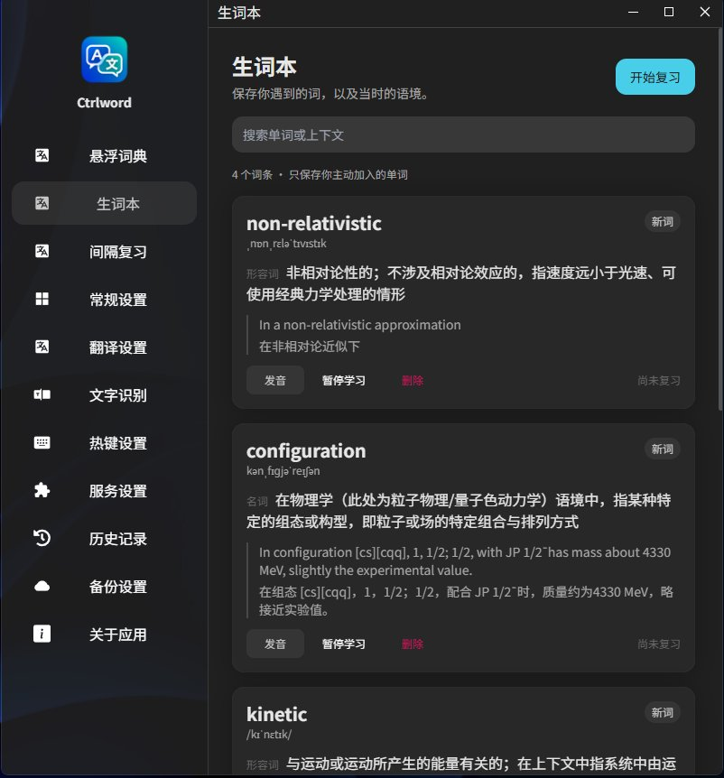

# Ctrlword

Windows 全局悬浮词典：读英文论文或文档时，鼠标停在单词上**轻按一次左 Ctrl**，释义、音标、常见搭配、例句和当前整句翻译就出现在鼠标旁边，不用切窗口、不用复制粘贴。

仓库：<https://github.com/viviviviviia/Ctrlword>　许可证：GPL-3.0-only

> 原名 CtrlHoverDict，0.1.7 起对外名称改为 **Ctrlword**；程序内部标识符（io.ctrlhoverdict.desktop、ctrlhoverdict.db）保持不变，所以旧版本的配置和生词本不会丢。基于 [Pot](https://github.com/pot-app/pot-desktop) 二次开发。


## 功能

- **轻按取词**：鼠标指向单词轻按并松开左 Ctrl。取词框默认 100×40，比光标略偏左上，指向单词下方的空白也能取到这个词。
- **带语境翻译**：除了词义，还会识别光标附近的一整句（按句号切句），给出「这个词在这句话里是什么意思」。
- **非激活浮窗**：卡片不抢焦点，你的输入光标还在原来的位置；按住卡片标题可以把它拖到别处。
- **词典字段**：音标、词性、释义、常见搭配、例句。普通翻译接口没有的字段留空，不编造。
- **生词本与间隔复习**：卡片上点「＋ 生词本」收藏，词条连同当时的语境一起存进本地 SQLite，按 SM2 算法安排复习。
- **发音**：优先用网络发音服务，取不到音频时自动回退到 Windows 内置语音，离线也能读。
- **框选翻译**：按住触发键拖动鼠标框选一片区域，识别后整块翻译。
- **多家翻译服务**：内置 DeepSeek、OpenAI、Gemini、DeepL、彩云、百度、有道、腾讯、Ollama 等服务，可在「服务设置」里挑主用和备用。
- **本地优先**：识别用 Windows 系统 OCR，失败再退回内置 Tesseract；查询结果本地缓存，重复查同一个词是秒开。

## 生词本



词条会保存单词、音标、词性释义、搭配、例句和**收藏时的那句话**，所以复习时看到的是当初遇到它的语境。右侧可以搜索词条或上下文，「新词」标签表示还没开始复习。

## 安装

1. 到 [Releases](https://github.com/viviviviviia/Ctrlword/releases) 下载最新的 `Ctrlword_<版本>_x64-setup.exe`。
2. 双击安装，默认装到 `%LOCALAPPDATA%\Programs\Ctrlword`，不需要管理员权限。
3. 重装或升级前请先从托盘退出程序，否则安装器不会覆盖正在运行的 exe。

## 第一次使用

1. 托盘图标右键 → **偏好设置**。
2. 左栏「悬浮词典」：填入翻译服务的 API Key（默认 DeepSeek，也可以换成其他服务），点「保存并测试当前服务」。
3. 确认「启用悬浮取词」是开着的，触发键为**左 Ctrl**，触发方式为**轻按一次**。
4. 回到任意文档或网页，把鼠标停在英文单词上，轻按一次左 Ctrl。

### 怎么拿到 DeepSeek 的 API Key

DeepSeek 开放平台：<https://platform.deepseek.com/>

1. 用手机号或邮箱注册并登录。
2. 左侧栏点 **API keys** → **创建 API key**，起个名字（比如 `Ctrlword`）。
3. 创建后**马上复制**这串以 `sk-` 开头的密钥——它只显示一次，关掉就看不到了。
4. 把它粘贴到软件的「悬浮词典 → API Key」里，点「保存并测试当前服务」。
5. 平台按用量计费，需要先在「充值」页充一点余额；消耗情况在「用量信息」里看。

不想用 DeepSeek 也可以：在「服务设置」里换成 OpenAI、Gemini、DeepL、彩云、百度、有道，或者用本机的 Ollama（完全离线）。

## 日常用法

| 操作 | 结果 |
| --- | --- |
| 指向单词，轻按一次左 Ctrl | 弹出词典卡片 |
| 指向单词**下方**的空白处轻按 | 同样取到这个单词 |
| 再轻按一次左 Ctrl / 按 Esc / 点别处 | 关闭卡片 |
| 按住卡片标题拖动 | 把卡片挪到不挡内容的位置 |
| 按住左 Ctrl 并拖出方框 | 框选区域翻译 |
| 卡片上「＋ 生词本」 | 收藏该词及其语境 |
| 卡片上「♪ 发音」 | 朗读单词 |
| 卡片上「复制」 | 复制释义与翻译 |

## 设置里能调什么

- **悬浮词典**：启用开关、触发键（左/右 Ctrl、左右 Alt、左 Shift）、轻按或按住模式、取词框大小与偏移、OCR 引擎、识别语言、译入语言、单个服务超时。
- **文字识别**：截图后手动识别并翻译。
- **生词本 / 间隔复习**：复习计划、每日配额、学习状态。
- **翻译设置 / 服务设置**：主用服务、备用顺序、模型、密钥、缓存清理。
- **热键设置 / 历史记录 / 备份设置**：全局快捷键、查询历史、数据导出与恢复。
- **常规设置**：开机启动、界面语言、代理等。

## 常见问题

**按了 Ctrl 没反应？**
先确认托盘菜单里「启用悬浮取词」是勾上的，再看「悬浮词典」页里触发键和触发方式对不对；如果当前程序在应用黑名单里也不会触发。仍然没反应就重启一次程序。

**提示 HTTP 503 / Service is too busy？**
这是服务端繁忙，不是网络问题。程序会自动重试三次；仍然失败可以到「服务设置」里换一个模型或备用服务，也可以过几分钟再试。

**卡片挡住了要看的文字？**
按住卡片标题就能拖动。卡片位置只在你手动拖动后才会保持在原处，重新取词会回到光标旁边。

**装了新版本但桌面图标还是旧的？**
Windows 会缓存图标，注销一次或重启资源管理器即可刷新。

**多显示器 / 高 DPI？**
取词框和卡片按物理像素计算，缩放比例不同的屏幕也能正确定位。

## 数据与隐私

运行数据在 `%APPDATA%\io.ctrlhoverdict.desktop\`：

- `config.json`：设置项，**API Key 以明文保存在这里**，请自行保管，不要提交到任何仓库。
- `ctrlhoverdict.db`：查询缓存、生词本、历史记录。
- `logs\`：运行日志，只记录耗时和错误，**不记录 API Key**。

识别在本机完成；只有被取到的文本会发给你配置的翻译服务。仓库里不含任何密钥，自动更新默认关闭。

## 开发与构建

本机验证环境：Windows x64、Node 24、pnpm 9.15.9、Rust 1.99.1、Visual Studio C++ Build Tools 2022、Windows SDK 10.0.26100、WebView2。

```powershell
pnpm install --frozen-lockfile
pnpm test
pnpm tauri dev
pnpm tauri build
```

项目固定 pnpm 版本。Tauri 启动器会查找用户目录的 `.cargo/bin`，无需为此修改系统 PATH。Windows 构建目标为当前用户安装的 NSIS exe。Rust 测试运行 `cargo test --manifest-path src-tauri/Cargo.toml`；测试使用 Node 内置 SQLite，建议 Node 24。

## 许可证与致谢

本项目以 **GPL-3.0-only** 发布，源自 [Pot](https://github.com/pot-app/pot-desktop)（GPL-3.0），保留其许可证与来源信息。第三方组件、图标与数据来源见 [THIRD_PARTY_NOTICES.md](THIRD_PARTY_NOTICES.md)。

翻译与 OCR 由各自服务提供，按服务商规则计费；软件本身免费。
